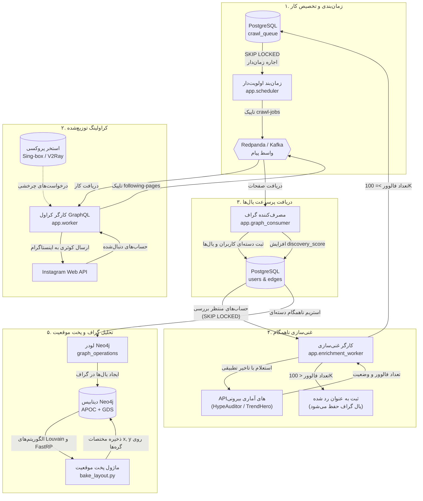

<p align="left" dir="rtl">
  <a href="./README.md">English</a> |
  <a href="./README.fa.md">فارسی</a>
</p>

<div dir="rtl">

# موتور کاوش و گراف شبکه‌های اجتماعی (SocialGraph Engine)

<p>
  <i>کراولر توزیع‌شده و پایپلاین پردازش داده رویدادمحور برای کشف ساختار و تحلیل گراف شبکه‌های اجتماعی در مقیاس بزرگ.</i>
</p>

<p>
  یک پلتفرم هوشمند تحلیل و کاوش شبکه‌های اجتماعی بر پایه Redpanda (Kafka)، PostgreSQL، پایگاه داده گرافی Neo4j همراه با Graph Data Science (GDS) و شبکه پروکسی خودترمیمی پویا.
</p>

---

## معرفی کلی (Overview)

نقشه‌برداری و تحلیل شبکه‌های اجتماعی در مقیاس‌های کلان با چالش‌های فنی متعددی روبروست: محدودیت‌های شدید نرخ درخواست (Rate Limits)، مکانیزم‌های ضدروبات، و چگالی بالای گراف که در آن یک حساب کاربری می‌تواند به ده‌ها هزار ارتباط متصل باشد. اسکریپت‌های تک‌پروسسی سنتی خیلی سریع مسدود شده، در صف انتظار فراخوانی‌های تکمیلی گیر می‌کنند، یا به دلیل حجم عظیم یال‌ها با کمبود حافظه مواجه می‌شوند.

**SocialGraph Engine** این موانع را از طریق یک معماری توزیع‌شده، ماژولار و رویدادمحور حل می‌کند:

- **کراولینگ توزیع‌شده مبتنی بر اولویت:** هماهنگی کارگرها (Workers) از طریق کافکا جهت پیمایش شبکه‌های ۱-هاپ و ۲-هاپ با استفاده از صف اولویت‌بندی لگاریتمی چندمعیاره.
- **تفکیک کامل ثبت داده از غنی‌سازی اطلاعات:** جداسازی جریان ذخیره‌سازی بلادرنگ یال‌ها از اعتبارسنجی فالوورها توسط صف‌های ناهمگام با قفل‌های غیرمسدودکننده (`SKIP LOCKED`).
- **مدیریت و چرخش خودترمیمی پروکسی‌ها:** چرخش چندپروتکلی (Sing-box، V2Ray، SOCKS5) همراه با تست خودکار تاخیر و قرنطینه در صورت محدودیت.
- **تحلیل گراف و پخت موقعیت دوبعدی (Layout Baking):** استریم بلادرنگ به Neo4j با تشخیص جوامع (Louvain)، تعبیه ساختاری گراف (FastRP) و پخت هندسی مختصات دوبعدی (Sunflower phyllotaxis) برای رندر بدون تاخیر در مرورگر با فیلتر سطح جزئیات (LOD).

## درباره من

من آرسام هستم، دانشجوی مهندسی کامپیوتر با تمرکز بر مهندسی داده، سیستم‌های توزیع‌شده، پردازش گراف و معماری‌های مقیاس‌پذیر بک‌اند.

این پروژه نقطه تلاقی این حوزه‌هاست: طراحی اسکرپرهای خطاناپذیر، هماهنگی صف‌های توزیع‌شده، پیاده‌سازی تراکنش‌های همزمان دیتابیس و اجرای الگوریتم‌های گرافی در مقیاس بالا.

کارهای دیگر من را در [پروفایل گیت‌هاب](https://github.com/the-mr-poarbear) ببینید.

## جریان کاری سیستم (System Workflow)

سیستم به شکل یک حلقه بازخوردی پیوسته کار می‌کند: داده‌های اولیه (Seed) وارد صف می‌شوند، کارگرها لیست ارتباطات را دریافت کرده، افراد جدید رتبه‌بندی شده و حساب‌های دارای تاثیر بالا برای کاوش عمیق‌تر مجدداً زمان‌بندی می‌شوند.



---

## مولفه‌های کلیدی معماری

### ۱. زمان‌بندی اولویت‌دار چندمعیاره

به جای پیمایش‌های کورکورانه BFS یا DFS، اولویت هر حساب با یک فرمول چندمعیاره لگاریتمی محاسبه می‌شود:

$$\text{Priority} = W_{\text{followers}} \cdot \ln(1 + \text{followers}) + W_{\text{seed}} \cdot \text{seed\_score} + W_{\text{discovery}} \cdot \ln(1 + \text{discovery\_score})$$

- **مقیاس لگاریتمی:** مانع از آن می‌شود که حساب‌های با فالوور بسیار بالا کل ظرفیت را تسخیر کنند و فرصت را از حساب‌های جدید اما متصل به شبکه بگیرند.
- **توازن نسبت کشف به سید (۸۰/۲۰):** ۸۰٪ ظرفیت کاری به حساب‌های تازه‌کشف‌شده با رتبه بالا و ۲۰٪ به حساب‌های اولیه تخصیص می‌یابد تا تعادل میان کشف مرزهای جدید و غنی‌سازی خوشه‌های اصلی حفظ شود.
- **قفل‌گذاری توزیع‌شده با `FOR UPDATE SKIP LOCKED`:** چندین نمونه زمان‌بند یا ورکر می‌توانند بدون مسدودسازی یکدیگر کارهای جدید را برداشت کنند.
- **بازیابی خودکار اجاره‌های منقضی:** هر وظیفه دارای زمان انقضای مشخص (`locked_until`) است؛ در صورت کرش کردن ورکر، تسک بدون توقف به صف بازمی‌گردد.

### ۲. ورکر کراولر پرسرعت مبتنی بر GraphQL

ورکرها از طریق اینترفیس وب داخلی و اندپوینت‌های GraphQL (کوئری‌های `edge_follow`) صفحات دنبال‌شدگان را با نشانگرهای بعد (`after`) استخراج کرده و به صورت بلادرنگ به کافکا تحویل می‌دهند.

### ۳. تفکیک ذخیره گراف از غنی‌سازی متادیتا

به دلیل اینکه کوئری‌های فالوور نیازمند بررسی پروفایل مجزا هستند، انجام این کار در حین کراول گلوگاه بزرگی ایجاد می‌کرد. سیستم این دو را جدا کرده است:
- **`graph_consumer`:** بلافاصله هزاران یال را در هر ثانیه در PostgreSQL ذخیره می‌کند و امتیاز اتصال (`discovery_score`) را افزایش می‌دهد.
- **`enrichment_worker`:** در پس‌زمینه با کنترل تاخیر تطبیقی (`AdaptiveDelay`)، حساب‌های پراتصال را از سرویس‌های عمومی استعلام کرده و در صورت رد کردن حد نصاب (مثلاً ۱۰۰ هزار فالوور) آن‌ها را برای کراول عمیق‌تر به صف اضافه می‌کند.

### ۴. شبکه خودترمیمی پروکسی

- پشتیبانی از پروتکل‌های Sing-box و V2Ray به صورت خروجی‌های لوکال SOCKS5.
- سنجش خودکار سلامت، پینگ و درستی آدرس IP به کمک `api.ipify.org`.
- تفکیک وضعیت و قرنطینه پروکسی‌هایی که با محدودیت (HTTP 429) یا تایم‌اوت روبرو می‌شوند.

### ۵. تحلیل داده و پخت موقعیت گراف برای نمایش وب

رندر کردن شبکه‌های بزرگ با میلیون‌ها گره روی مرورگر کاربر باعث قفل شدن موتور جاوااسکریپت و WebGL می‌شود. سیستم ما مختصات $(x, y)$ را روی سرور پیش‌محاسبه می‌کند:
1. **خوشه‌بندی لووین (Louvain):** تفکیک ساختار شبکه به جوامع ماژولار در زمان خطی $O(E)$.
2. **امبدینگ FastRP:** ایجاد بردار ساختاری گره‌ها در مقیاس بزرگ.
3. **تصویرسازی آفتابگردانی (Sunflower Phyllotaxis):** قرار دادن هسته هر جامعه بر اساس زاویه طلایی آفتابگردان، پخش اعضا حول مرکز بر اساس بردارهای FastRP و هدایت گره‌های ایزوله به کمربند بیرونی.
4. **ذخیره روی گره‌های Neo4j:** ثبت مستقیم `x` و `y` روی گره‌ها، به طوری که فرانت‌اند می‌تواند با کوئری‌های فیلتر شده بر اساس فالوور (LOD) در میلی‌ثانیه گره‌ها را دریافت کند.

---

## راه‌اندازی سریع

### ۱. زیرساخت داکر

```bash
git clone https://github.com/the-mr-poarbear/social-media-search-engine-graph.git
cd social-media-search-engine-graph
docker compose up -d
```

### ۲. نصب وابستگی‌ها و مهاجرت دیتابیس

```bash
python -m venv venv
venv\Scripts\activate
pip install -r requirements.txt
alembic upgrade head
```

### ۳. بارگذاری داده‌های اولیه و شروع

```bash
# بارگذاری سید
python -m scripts.load_seed data/seed_sample.csv

# اجرای همزمان کل خط لوله در تب‌های ترمینال
python start_pipeline.py --consumers 4 --enrichers 2 --workers 1
```

### ۴. انتقال داده و پخت گراف در Neo4j

```bash
python -m graph_operations.load_nodes
python -m graph_operations.load_edges
python -m graph_operations.bake_layout --scaling-factor 3000 --dimension 16
```

---

## ویژگی‌های برجسته فنی

- معماری کاملاً رویدادمحور و مستقل با Redpanda/Kafka.
- همزمانی بدون تداخل با استفاده از PostgreSQL `SKIP LOCKED`.
- پخت آفلاین مختصات دوبعدی برای رندر وب شبکه‌های عظیم در مقیاس میلیون‌ها گره.
- مدیریت و قرنطینه خودکار پروکسی‌ها با پروتکل‌های مدرن فیلترشکن.
- فرمول اولویت‌بندی لگاریتمی جهت ممانعت از تک‌قطبی شدن صف کراول.

## تکنولوژی‌های استفاده‌شده

**Python · Redpanda / Apache Kafka · PostgreSQL · SQLAlchemy 2.0 (asyncpg) · Alembic · Neo4j & Graph Data Science (GDS) · Docker · Sing-box / V2Ray · NetworkX · NumPy · Scikit-Learn**

## سازنده

**آرسام امیرسلیمانی**

دانشجوی مهندسی کامپیوتر با تمرکز بر مهندسی داده، سیستم‌های توزیع‌شده و تحلیل گراف.

- [پروفایل گیت‌هاب](https://github.com/the-mr-poarbear)

</div>
